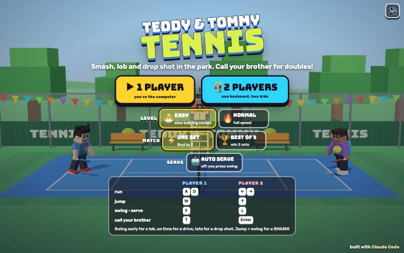

# Tennis: Teddy & Tommy

[](https://adong.github.io/tennis-teddy/)

Press **?** any time (or tap the round **?** button on the left edge) to see the keys. The game waits while you look.
Tap **中文 / EN** under it to switch between English and 中文 (the dashboard and every game remember the choice).

A side-view cartoon tennis game starring Teddy and Tommy, in the spirit of the old flash tennis games. It's built with Claude Code from plain JavaScript and Three.js, on the shared Claude Games kit.
There are no image, model or audio files: the players are the kit's blocky characters, every texture is painted on a canvas, and every sound is synthesised.
Rallies are bouncy and easy to read. The ball has a round shadow right under it on the court, so you can see where it'll come down, and on Easy a yellow ring shows where it will bounce.
Either player can call in the other brother. He runs onto your side for about 10 seconds of doubles, hands you a treat, returns the balls you can't reach, and saves one ball that gets past you.

The name is a working title. It lives in one place, `js/title.js`.

## Play

- **Double-click `index.html`.** It works offline because Three.js and the kit are copied into `kit/`. Without internet the title font falls back to Arial Black.
- **Send one file:** `dist/tennis-teddy.html` is the whole game inlined, about 800 KB. AirDrop or email it, then open it in a browser.
- Rebuild that file after any edit: `python3 kit/tools/bundle.py . --name tennis-teddy`

**1 PLAYER** is you against the computer, and **2 PLAYERS** is two kids on one keyboard. The title screen has three settings, which are remembered:

- **LEVEL**
  - **🐣 EASY**, for little players like Tommy (5): the ball flies at 78% speed, your racket reaches further, you can swing again straight away, and a ring shows where the ball will bounce. The computer is slow, misses a lot, and hits the ball back to you.
  - **🔥 NORMAL**, for big kids like Teddy (8): full speed. The computer runs faster, places the ball away from you, smashes, and calls its own companion when it's behind.
  - In 2-player mode the level only sets the ball speed and the racket size.
- **MATCH**: ⚡ **ONE SET** (first to 7, win by 2) or 🏆 **BEST OF 3** sets.
- **🤖 AUTO SERVE**: your serve goes by itself a moment after you're ready. With it off, you press swing to serve.

## Controls

| | Player 1 | Player 2 | Touch (1 player) |
|---|---|---|---|
| run | A D | ← → | hold ◀ ▶ |
| jump | W | ↑ | ⤒ JUMP |
| swing / serve | F | L | 🎾 SWING |
| call your brother | T | Enter | tap his face (above the buttons) |

- In 1-player mode both key sets control you, and Space swings too.
- **P** or Esc pauses, and **M** turns the sound on or off. During a match the ❚❚ and 🔊 buttons sit under the set number; on every menu screen the 🔊 button is in the top right corner.
- **Menus:** on the title screen, Enter starts 1 player, 2 starts 2 players, ← → switch the level and 3 switches the match length.
  - On the player screen, tap a card or use A D + F (player 1) and ← → + L (player 2). Esc goes back.
  - In 1 player you pick yourself first, then who you play (Enter works as F). In 2 players both lock in, or Enter starts.

## How to hit

Every swing sweeps the racket from behind you to out in front. Where it meets the ball decides the shot:

| Shot | How | What it does |
|---|---|---|
| **LOB** | swing early, so you meet the ball out in front | high and deep, over a player at the net |
| **CROSS** | swing early while running at the net | fast, deep and across the court |
| **DRIVE** | swing on time, the ball by your body | the normal shot: flat and quick |
| **DROP SHOT** | swing late, the ball by your back foot | soft, just over the net, and it hardly bounces |
| **SMASH** | jump (W / ↑ / ⤒) and swing at a high ball | very fast and steep. Teddy smashes from his 🏀 jump-shot pose |

- The game aims every shot so it clears the net and lands in. On Normal, a swing at the very first or very last moment can still go into the net or long.
- **Serving:** press swing to toss the ball. It's hit on the way down, or press swing again at the top for a **POWER SERVE**. Serves always go in (kid rules), and the players take turns serving every point.
- **Kid rules:** the ball may bounce once on your side, or you can hit it before it bounces. You win the point if it bounces twice on their side, lands **OUT** past their baseline, or they hit it into the **NET**.
- **Scoring:** first to 7 points, win by 2, with "1–LOVE!", "3 ALL!", "DEUCE!", "ADVANTAGE TEDDY!", "SET POINT!" and "MATCH POINT!" calls.
- The friend in the umpire's chair follows the ball with his head. It's whoever isn't playing: Bolt, Bruno, Luna, Zoom or the zombie.

## Celebrations

- **Teddy** wins a point with his Mike Tyson-style **boxing combo** (peek-a-boo guard, jab, straight). After a smash winner he does his **🏀 jump shot** instead, and the basketball flies off with a SWISH.
- **Tommy** does his **Y pose (比耶)**: both arms up with peace fingers.
- Everyone else waves. The player who lost the point hangs his head for a moment, then gets ready again.

## Call your brother (companion mode)

Your companion is the other brother: **Tommy** comes for everyone, and **Teddy** comes when Tommy is playing. Each side has its own, the CPU included. The player screen shows him under each player ("+ buddy TOMMY"). If both sides get the same brother, the second one wears different colours, and his name tag is in his caller's colour (blue for player 1, red for player 2).

- **Calling him:** press T (player 1), Enter (player 2) or his face button on a touch screen. He runs in from behind your baseline with his name tag.
  - **Teddy** says hi with his boxing combo, and bye with a 🏀 jump shot.
  - **Tommy** says hi and bye with his Y pose.
- **The treat:** after his hello he hands you a treat (🍦 💧 🧃 🍪 🍉 🍌), with a toast like "🍦 ICE CREAM FROM TOMMY!". It flies into your free hand and you hold it for a few seconds.
- **Doubles:** for about 10 s he plays the half of your court you're not in, at the net while you're at the back, and at the back if you come in. After each shot from the other side he checks whether you can get to the ball in time. If you can't, he goes for it and hits it back.
- **He's got your back:** the first ball that gets past you during his visit (one that would bounce twice on your side) is saved. Time slows down, he dives across, and pops it back over: "TOMMY SAVED IT!". After that, he still plays, but there are no more saves until you call him again.
- **The HUD:** the bar with his face under your name shows how much of his visit is left. It glows while he's there, as does the touch button.
- **Press again while he's there** and he gives you another treat and does his hello move again. He doesn't stay longer.
- **Calling him again:** in 1 player you can call him again as soon as he's gone, as often as you like. In 2 players he rests for **4 s** after each visit, so it stays fair: his face goes grey and the bar refills, and pressing then just makes the bar wiggle.
- **The CPU** calls its companion on Normal when it's 2 points behind, at most every 30 s. On Easy it never does.

## How it works, and how it's tested

- **The engine** (`js/match.js`) has no Three.js and no DOM. A match is plain state stepped at a fixed 60 frames a second, and the same code runs the browser game and the headless tests.
  - The ball has gravity, bounces with per-shot spin, and hits or clears the net.
  - The shot solver takes the contact point, the shot type and a landing spot, and works out the flight time and speed that clear the net with some room to spare.
  - The rules count bounces per side, and run the serve, points, sets, the match and the companions.
  - `TTMatch.plan()` looks ahead along the ball's flight and picks where to stand and when to swing. The CPU and the companion both use it.
- **The CPU** (`js/cpu.js`) plans a return, then spoils it on purpose: it reacts late, stands a bit off, swings a few frames early or late, sometimes just watches the ball go by, and gets sloppier when it has to run far.
- **The renderer** (`js/game.js`) only reads match state and turns `match.events` into bursts, sounds, the umpire's calls and celebrations. A CPU-vs-CPU demo plays behind the menus.
- **Headless match runner** (node, no browser):

```bash
node tools/soak.js
```

```bash
node tools/soak.js 5 --max 600
```

```bash
node tools/soak.js --versus eight normal 100
```

  The first plays 200 random matches (CPUs and test bots, one set or best of 3, random characters) and exits 1 if any doesn't finish or throws. The second proves that check can fail: matches cut off after 10 s are reported unfinished, with exit code 1. The third gives win counts for one pairing.

- **Test bots**, stand-ins for real kids:
  - `kid` wanders, jumps a lot, presses swing every 0.25–0.75 s and calls his brother now and then.
  - `masher` chases the ball and presses swing every 0.1–0.25 s.
  - `eight` really plays: it runs to the ball and times its swings, but late and loose, with no aim.
  - `eightBud` is the same, and keeps his brother on court the whole time.
- **At the last check:**
  - 200 of 200 random matches finished with no errors. They had 15 points on average and lasted about 3 minutes of game time.
  - Against **Easy**: `kid` won 100 of 100 matches (701 points to 168), `masher` won 100 of 100, and `eight` won 79 of 100.
  - Against **Normal**: `kid` won 3 of 100. `eight` won 21 of 100 on his own (462 points to 681), and 88 of 100 with his brother on court.
  - CPU-vs-CPU rallies on Normal last about 6 hits (median).
- **Console hooks** (`window.game`), for the browser:

```js
game.start({ p1: 'teddy', p2: 'tommy', mode: '1p', level: 'easy', sets: 1, auto: true }) // straight into a match
game.step(5)              // advance 5 s and draw (when the tab's animation is throttled)
game.hold(true)           // stop the live loop, so only step() moves time
game.buddy(0)             // call player 1's companion (game.buddy(1) for player 2)
game.press(0, { right: true }, 30)  // hold keys for a side for 30 frames
game.cpu(0, 'normal')     // let the CPU play a side
game.celebrate(0, 'jumpshot')       // play a celebration
game.freeze(true); game.look(-1, 1.2, 6)  // stop the clock and look close up, to check poses
game.soak(50); game.sim({ who: ['eight', 'normal'] }); game.versus('kid', 'easy', 20)
```

## Files

```
index.html        page, HUD, menus, touch buttons (CSS inline)
js/title.js       the game's name, in one place
js/match.js       the engine: ball physics, shot solver, rules, scoring, serve, companions, the return planner
js/cpu.js         CPU levels, test bots, headless sim / soak / versus
js/input.js       keyboard for two players, touch buttons
js/poses.js       the racket, forehand / low / overhead swings, serve toss, ready, sad, dive; Kit poses for celebrations
js/stage.js       the park court: lines, net, fence and windscreen, bunting, trees, benches, the umpire's chair, sky
js/fx.js          the ball, its shadow and trail, the landing ring, POW bursts, dust, confetti, flying emoji
js/sfx.js         tennis sounds on top of Kit.sound
js/game.js        scene, camera, screens, HUD, companions and treats, main loop, window.game hooks
js/keys.js        the keys the ? panel shows (Kit.help)
js/zh.js          中文: the page's words, the umpire's calls, toasts, POW bursts and the ? panel (Kit.lang)
tools/soak.js     the headless match runner (node)
kit/              copy of ~/claude-games/kit (python3 ../kit/tools/sync.py .), never edited here
dist/tennis-teddy.html   the single-page build
```

## Kit candidates

These live in this game's own JS for now. They could move into `~/claude-games/kit` if another game wants them:

- **The racket** (`js/poses.js`): a racket that sits in the hand with a wrist joint, and `arm(p, side)`, which puts it in the hand nearer the camera.
- **A `drive(p, targets, k)` helper** (`js/poses.js`): it eases every channel of a kit person, including the wrist, leg spread, crouch and rig tilt, which the kit's `pose` doesn't touch.
- **Swing curves** (`js/poses.js`): forehand, low and overhead, as key curves over the swing.
- **The return planner** (`TTMatch.plan` in `js/match.js`): it looks ahead along a ball's flight to choose where to stand and when to act. Any ball game could use it (volleyball, a hoops rebound).
- **Effects** (`js/fx.js`): a blob shadow that shrinks and fades with height, and a landing-spot ring.
- **Sounds** (`js/sfx.js`): racket pock, smash, bounce, net, crowd cheer, umpire whistle.

## Not verified

- **Sound**: the synth code runs without errors, but nobody listened to it.
- **Real touch devices**: the touch buttons (the companion button included) were tested in the browser's phone emulation (740×360) with synthetic pointer events, not on a real phone or iPad. Two thumbs at once (run and swing) is untested.
- **Double-click from Finder (`file://`)**: the page only uses classic `<script src>` tags and no network requests apart from the optional Google font, but it was tested over `http://localhost`, because the test browser can't drive `file://` pages.
- **Real kids**: the levels were tuned against test bots, not against Teddy and Tommy.
